# AireMañana — tomorrow's air for a Madrid school

**Track:** AI + Climate · **Team:** solo entry

- **Live website:** https://julianjms-beep.github.io/aire-manana/ (English / Español, updated every evening)
- **Notebook (runs end to end in Colab, explained step by step):** [AireManana.ipynb](https://colab.research.google.com/github/julianjms-beep/aire-manana/blob/main/AireManana.ipynb)
- **One-page write-up:** [WRITEUP.md](WRITEUP.md)

> This project is a prototype and is not medical advice.

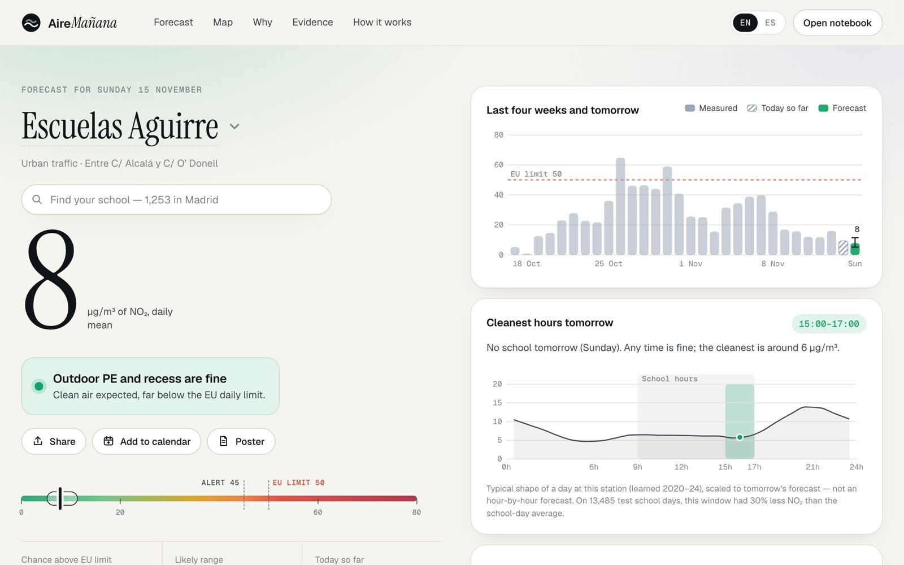

## In one minute

- Every evening AireMañana forecasts **tomorrow's nitrogen dioxide (NO₂)** for all **24 official stations** in Madrid
  and turns it into a decision a teacher can act on: *outdoor PE and recess are fine*, *keep an eye on it*, or *move PE indoors*.
- Tested on **932 days it had never seen**, using the weather forecast that really existed the evening before, its error
  is **44 % lower** than "tomorrow will be like today", and it wins at **all 24 stations**.
- **Our finding:** Madrid got so much cleaner that a model trained on the past keeps expecting pollution that no longer
  comes. AireMañana checks its own errors of the last 30 days every evening and removes them (bias in 2026: +8.2 → −0.2 µg/m³).
- Any of Madrid's **1,253 schools** can find its forecast, add it to a calendar, share it on WhatsApp or print a poster.
  The site also suggests the **cleanest two hours for PE** — on test days, 30 % less NO₂ than the school-day average.
- Every forecast is **saved before its day happens** and checked afterwards: a test that grows every evening.

## The problem

Nitrogen dioxide (NO₂) comes mostly from traffic. It inflames the airways, and children with asthma feel it first.
From 2030 the EU allows a daily mean above 50 µg/m³ on at most 18 days a year (Directive 2024/2881).

Air-quality apps tell you about **today**. A school needs to know about **tomorrow**, and it needs to know at about 6 pm,
when it plans the next day's PE classes and recess. AireMañana answers exactly that question for every official
station in Madrid, with a reason a teacher can read.

## What a teacher gets

| | |
|---|---|
| **Tomorrow's forecast** | the daily mean NO₂, a likely range (10th–90th percentile) and the chance of going over the EU limit, for any of the 24 stations |
| **A clear decision** | 🟢 *Outdoor PE and recess are fine* (below 35 µg/m³) · 🟡 *Keep an eye on it* (35 or more) · 🔴 *Move PE indoors* (above 45, the alert) |
| **Why this forecast?** | how much each factor pushes tomorrow up or down: recent levels, weekday or holiday, season, rain, wind, temperature, self-correction |
| **Find your school** | type the name of any of 1,253 schools and nurseries; you get the nearest station and how far away it is |
| **Cleanest hours tomorrow** | the best two-hour window for PE between 9:00 and 17:00, from the station's typical day |
| **Calendar** | subscribe once in Apple, Google or Outlook Calendar; tomorrow's decision appears there every evening |
| **Share** | a ready-made image for WhatsApp or Instagram with tomorrow's forecast for your school |
| **Poster** | a printable A4 page with a QR code that opens your school's forecast, for the staff room |
| **Installable app** | add it to your phone's home screen; it opens offline with the last forecast |
| **Map of the city** | all 24 stations ranked by tomorrow's level, and every school on the map |
| **Live record** | every published forecast next to what was measured |

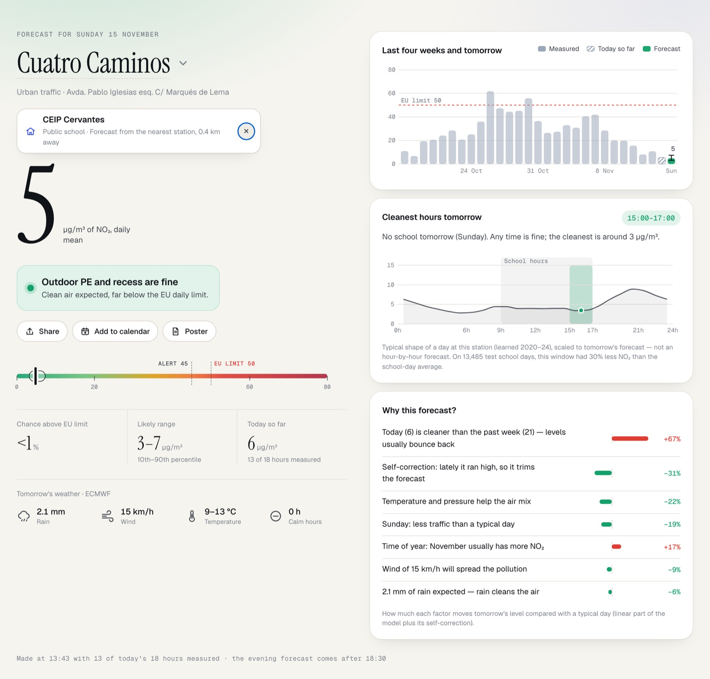

<p align="center">
  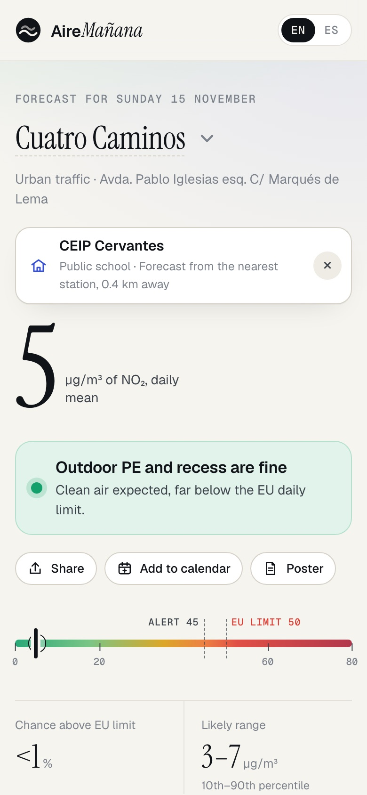
  &nbsp;
  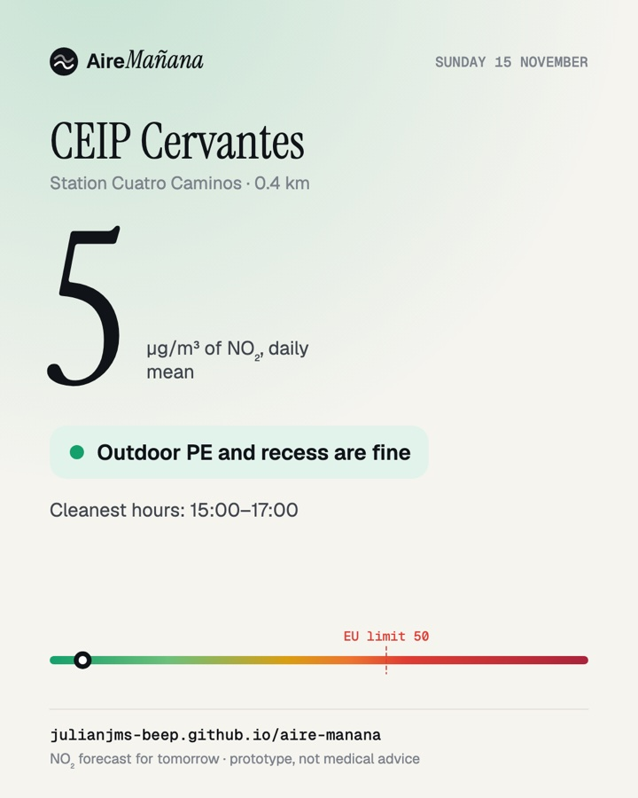
  &nbsp;
  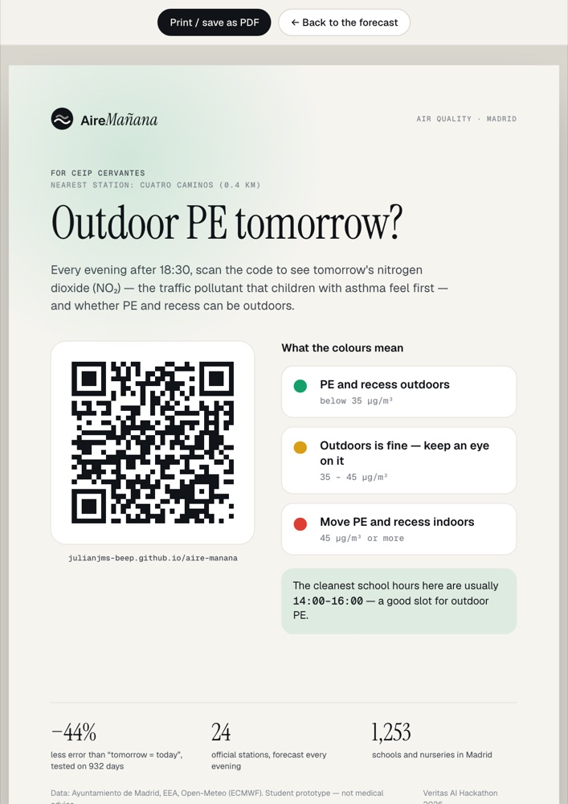
</p>
<p align="center"><em>On a phone · the image the Share button makes · the printable poster</em></p>

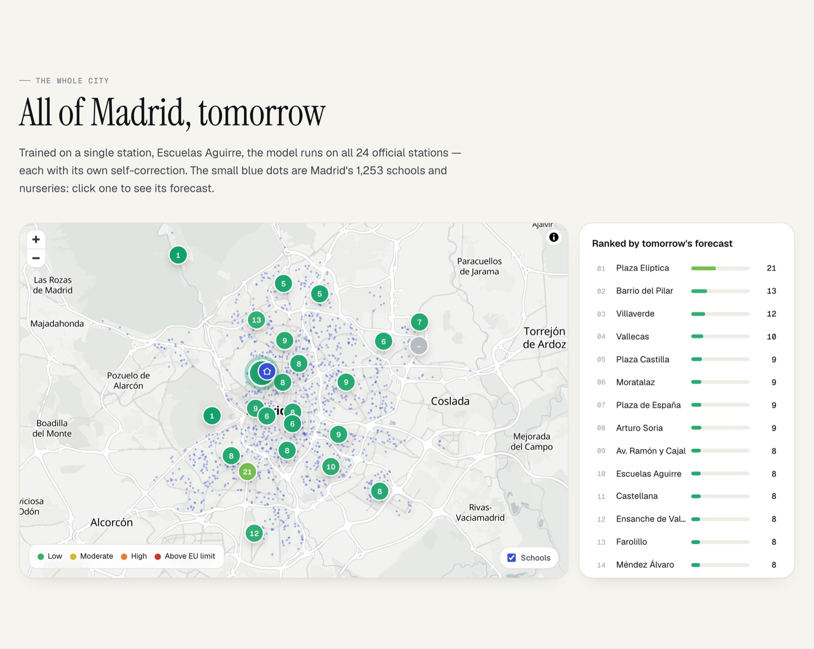

## How it works, in plain words

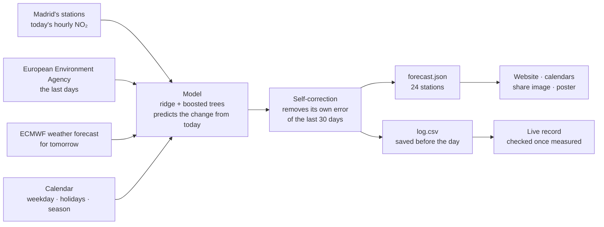

1. **Every evening at about 18:35** (Madrid winter time) a GitHub Action wakes up and downloads today's hourly NO₂ from
   Madrid's real-time file, the last days from the European Environment Agency, and ECMWF's newest weather forecast.
2. **The model** looks at what is known at that moment: NO₂ so far today and in recent days, tomorrow's forecast rain,
   wind, calm hours, temperature and pressure, and the calendar. It predicts **how tomorrow will change from today**
   (on a log scale), not the level itself, because *how* weather and weekdays move pollution stays stable while the city
   gets cleaner. It is the average of two models: a ridge regression (linear) and gradient-boosted trees.
3. **The self-correction.** The model compares its forecasts of the last 30 days that can already be checked with what was
   measured, and removes that average error from tomorrow's forecast. This is version 2, and it is what fixed the drift.
4. **Range and chance.** The model's past errors on validation days are added to tomorrow's forecast. The middle 80 % of the
   results is the *likely range*; the share above 50 µg/m³ is the *chance of a bad day*.
5. **The decision.** Alert (move PE indoors) when the forecast is above 45 µg/m³ — the highest threshold that still caught
   at least 85 % of bad days in validation, because a missed bad day is worse for a child with asthma than an indoor class.
6. **Saved before the day happens.** Every forecast, with what "tomorrow = today" would have said, is committed to
   `web/data/log.csv`. The evening after its day, the measured value is written next to it.
7. **Published.** The Action rewrites 48 calendar files (24 stations × 2 languages) and publishes the site on GitHub Pages.

The model is trained on one station (Escuelas Aguirre, urban traffic) and then run, without re-training, on all 24.
Each station gets its own self-correction from its own recent errors.

| | |
|---|---|
| NO₂ | 2,436,010 official hourly values from the 24 stations of Madrid, 2015 → today (Ayuntamiento de Madrid; recent days from the EEA) |
| Weather | ERA5 for history; for testing, **the ECMWF forecast that was really available the evening before** (not the weather that happened); the live ECMWF forecast for tomorrow |
| Calendar | weekday, Madrid public holidays, season |
| Target | tomorrow's daily mean, predicted as the change from today (log scale) |
| Model | average of a ridge regression and gradient-boosted trees (scikit-learn), plus the 30-day self-correction |
| Splits | train Jul 2020 – Dec 2022 · validation 2023 – Feb 2024 (choose model and alert threshold) · **test Mar 2024 – Oct 2026 (932 days, never used to choose anything)** · live from Nov 2026 |
| Alert | forecast above 45 µg/m³, the highest threshold that still caught ≥ 85 % of bad days in validation |
| Uncertainty | likely range (10th–90th percentile) and P(> 50 µg/m³) from the validation errors |
| Schools | 1,253 education centres from Madrid's open data, each linked to its nearest station (haversine distance) |
| Cleanest hours | each station's typical day (hour ÷ daily mean) for school days, Saturdays and Sundays/holidays, cold and warm half-year, learned on the training years |

## How we kept the test honest

- **Time order, never shuffled.** The model is fitted on the past and scored on the future, like in real life.
- **Only what is known at 18:00.** For *today* the model only sees the hours from 00:00 to 18:00.
- **Real weather forecasts.** In the test, tomorrow's weather is the ECMWF forecast archived the evening before
  (Open-Meteo Previous Runs), not the weather that happened. With the real weather the error would only fall from 4.4 to 4.2.
- **Every choice on validation.** The model, the training years and every alert threshold were chosen on 2023 – Feb 2024.
  Each baseline gets its own threshold with the same rule, so the comparison is fair.
- **Said openly:** the test was scored twice — once for v1, and again for v2 after we found the drift. The fix was designed
  on validation data only.
- **A test nobody can tune.** Since 14 Nov 2026 every forecast is committed to Git before its day happens, with a timestamp,
  and checked once the day has been measured.

## Results (held-out test, 932 days, Escuelas Aguirre)

| Method | Mean absolute error (µg/m³) | Bias | Bad days caught (of 45) | False alarms |
|---|---|---|---|---|
| Baseline: "tomorrow = today" | 7.97 | −2.1 | 38 | 223 |
| Weekday rule | 7.82 | +0.9 | 34 | 153 |
| AireMañana v1 (no self-correction) | 7.49 | +6.3 | 36 | 58 |
| **AireMañana v2** | **4.44** | **−0.3** | 30 | **30** |

Each method uses its own alert threshold, chosen on validation.

- **44 % lower error than the baseline** (4.4 vs 8.0 µg/m³).
- **Same number of false alarms, more than twice the bad days caught.** With 30 false alarms in the test period, v2
  catches 30 of 45 bad days and "tomorrow = today" catches 13. With 60 false alarms: 39 vs 18. The baseline only catches
  more at its own threshold by raising 223 false alarms — PE indoors on more than one day in four for nothing.
- **Uncertainty.** When the model gave a 40–60 % chance of a bad day, it happened 44 % of the time. The 80 % likely range
  contained the true value on 75 % of test days, so it is a bit too narrow.

<p align="center">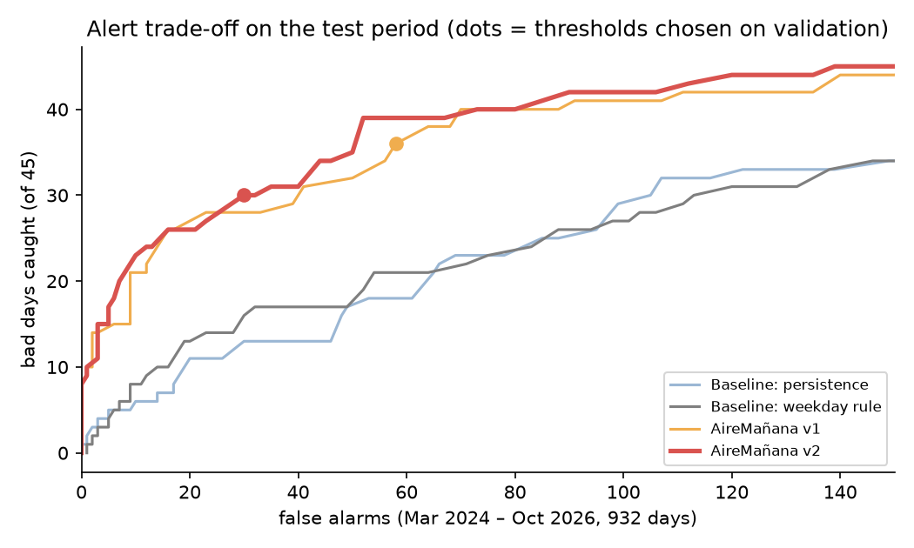</p>

### The drift we found

Madrid's NO₂ halved in ten years: Escuelas Aguirre broke the 2030 limit on 267 days in 2017 and on 22 in 2025. A model
trained on the past keeps expecting that old pollution. v1 over-predicted more every year (+4.4 µg/m³ in 2024, +6.3 in
2025, +8.2 in 2026). Neither training on more years nor predicting the level instead of the change fixed it. The 30-day
self-correction did: bias −0.3, error 7.5 → 4.4.

<p align="center">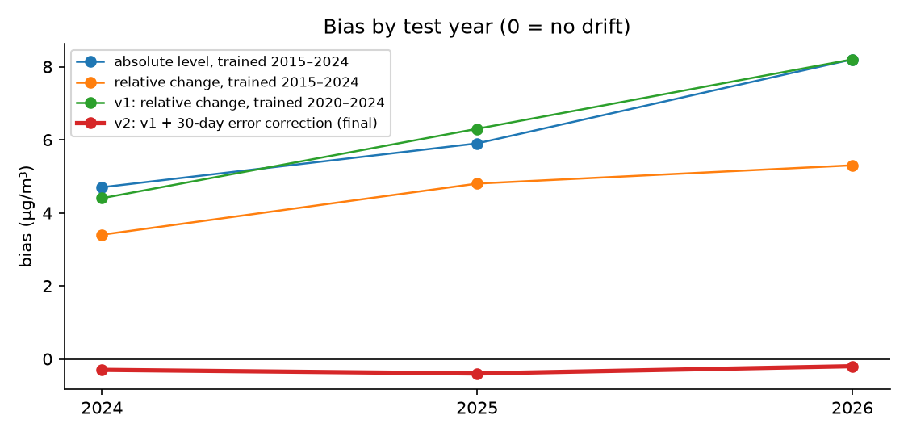</p>

### The whole city

It beats the baseline at **all 24 stations** (17–44 % lower error), although it was trained on only one of them.
Version 1 was *worse* than the baseline at 14 of them, mostly the clean ones, where expecting "old Madrid" hurts most.
The self-correction fixed that.

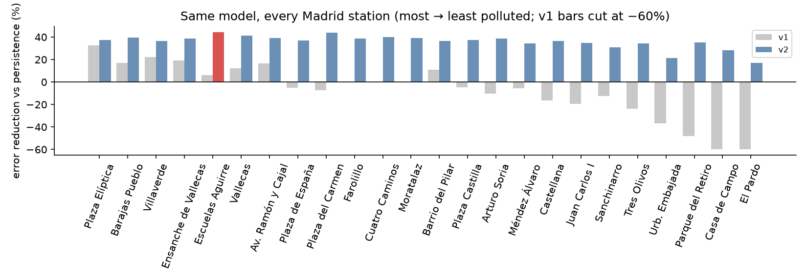

### Cleanest hours for PE

NO₂ follows the traffic: it peaks in the morning rush (around 8:00–9:00, when children arrive), falls after lunch and
rises again in the evening. The cleanest school-day window is 14:00–16:00 at most stations from October to March, and
15:00–17:00 at almost every station from April to September. Checked on 13,485 school days × stations in the test period,
which were never used to learn the shapes:

| Two-hour window | Mean NO₂ (µg/m³) |
|---|---|
| **Suggested by AireMañana** | **14.8** |
| Whole school day (9:00–17:00) | 21.1 |
| First lesson (9:00–11:00) | 30.4 |
| Cleanest, known only afterwards | 12.9 |

The suggestion was the single cleanest window on 50 % of days, one of the two cleanest on 72 %, and cleaner than the
school-day average on 90 %. It is a typical day, not an hourly forecast, and the site says so.

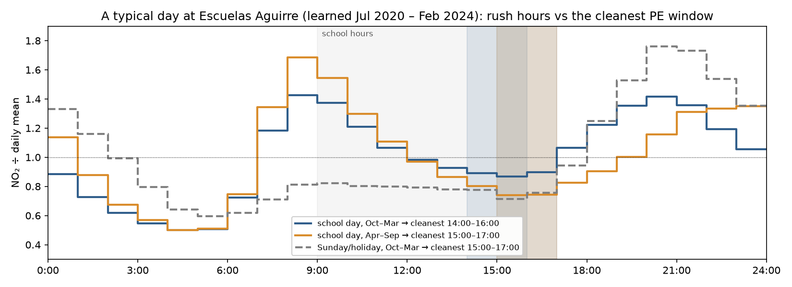

### From 24 stations to 1,253 schools

Half of the schools are within 1.3 km of a station, three in four within 2 km and nine in ten within 3 km. The farthest
are at the edges of the city, where stations are fewer. The website always shows the distance, because the nearest
station is not the school's own air.

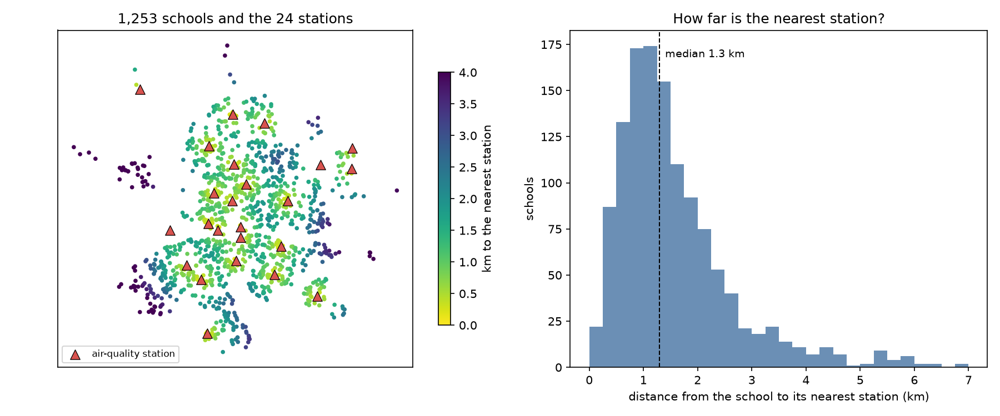

### Where it fails

- At the threshold chosen on validation it caught 30 of 45 bad days in the test (67 %), below the 85 % it reached in
  validation, because bad days became rarer. The trade-off curve on the website shows every threshold.
- It misses sudden jumps on calm, dry autumn days that follow a clean day (e.g. 26 Oct 2026: forecast 36, measured 65).
- The weather forecast is not the main problem. With the weather that really happened, the error would only fall from
  4.4 to 4.2.
- It only covers NO₂, not ozone or particles. Central Madrid's weather is used for every station.
- A school gets the forecast of its nearest station; a playground next to a busy road can be dirtier than its station.
- The cleanest hours come from a typical day, not from an hourly forecast.
- The test period was scored twice: once for v1, and again for v2 after we found the drift. The fix was designed on
  validation data only.

## What we'd do next

- A pilot with a real school, with push alerts on top of the calendar.
- Ozone in summer, and local weather for every station.
- Train on all 24 stations at once, so each one learns from the others.

## FAQ

**Why NO₂ and not particles or ozone?** NO₂ is Madrid's traffic pollutant, the one that breaks the EU daily limit and the
one low-emission zones target. Ozone peaks on summer afternoons and needs its own model — it is the next step.

**Why forecast the daily mean, not every hour?** The EU limit is set on the daily mean, and the decision (PE outdoors or
indoors) is taken once, the evening before. The *cleanest hours* tip then uses each station's typical day.

**Why does the alert start at 45 and not at 50?** Every forecast has errors. A missed bad day is worse for a child with
asthma than an indoor PE class, so the threshold was set lower: the highest one that still caught 85 % of bad days in
validation.

**Why train on only one station?** It kept the study simple and gave a strong check: the same model, run on 23 stations it
never saw, still beats the baseline everywhere once each station corrects itself. Training on all 24 is next.

**Does it know about weekends and holidays?** Yes. Weekday, Madrid public holidays and season are inputs, and the
cleanest-hours tip uses a different typical day for school days, Saturdays and Sundays or holidays.

**What if a station has no data today?** It is shown in grey on the map and the other stations keep working.

**How do I get it in my calendar?** Choose your station or school on the website, press *Add to calendar* and pick Apple,
Google or Outlook. The calendar refreshes by itself; past days show the measured value.

**Is it medical advice?** No. It is a student prototype. Follow official health advice and the City of Madrid's
air-quality notices.

## Run it

```bash
pip install -r requirements.txt
python make_site_data.py evaluate     # test-period results                    -> web/data/evaluation.json
python make_site_data.py live         # tomorrow's forecast, log and calendars -> web/data/forecast.json, log.csv, web/cal/
python make_site_data.py calendars    # only the calendar files               -> web/cal/*.ics
python make_site_data.py schools      # schools -> nearest station            -> web/data/schools.json
python make_site_data.py profiles     # typical day per station + test check  -> web/data/profiles.json
cd web && python -m http.server       # the website at http://localhost:8000
```

The processed daily tables are in `data/`, so `evaluate` and `live` work right after cloning. `profiles` needs the hourly
history (about 80 MB): `python -c "from madrid_data import download_history; download_history()"`. The notebook downloads
it by itself on its first run (in Colab, or locally with `pip install jupyter`).

A GitHub Action (`.github/workflows/daily.yml`) runs `make_site_data.py live` every evening, commits the forecast, the
log and the calendars, and publishes `web/` to GitHub Pages.

## Repository

```
AireManana.ipynb        the full study with explanations: data, baselines, model, test, drift, stations, schools, cleanest hours, live record
WRITEUP.md              one-page write-up
madrid_data.py          downloads and cleans the NO₂ data (history, real time, EEA) and the weather (ERA5, archived and live ECMWF)
forecast_model.py       features, the model (ridge + boosted trees + self-correction), baselines and scores
live.py                 tomorrow's forecast for one station, with range, probability and reasons
make_site_data.py       builds everything the website reads: evaluate, live, calendars, schools, profiles
data/                   processed daily NO₂ and weather, station list, validation errors (residuals.json)
figures/                charts from the notebook
docs/                   screenshots for this page
.github/workflows/      the evening job: forecast, save, publish
web/                    the website — static HTML, CSS and JavaScript (D3, MapLibre), no server
  index.html · app.js · i18n.js · style.css
  poster.html           printable A4 poster with a QR code
  manifest.webmanifest · sw.js · icons/    installable app that works offline
  og.png                preview image for links shared on WhatsApp and social media
  cal/                  48 calendar feeds (.ics), rebuilt every evening
  data/                 forecast.json · log.csv · evaluation.json · profiles.json · schools.json
```

## Sources

**Data**
- Ayuntamiento de Madrid, open data: hourly air quality (dataset 201200), real-time air quality (212531),
  station list (212629), education centres (300614, CC BY 4.0). https://datos.madrid.es
- European Environment Agency: up-to-date air quality data (E2a). https://eeadmz1-downloads-webapp.azurewebsites.net/
- Open-Meteo: ERA5 historical weather, archived ECMWF IFS forecasts (Previous Runs API), live forecast. https://open-meteo.com
- EU Directive 2024/2881 on ambient air quality: NO₂ daily limit of 50 µg/m³, at most 18 days a year from 2030
  ([EEA summary](https://www.eea.europa.eu/en/analysis/publications/air-quality-status-report-2025/benchmark-analysis-against-the-standards-in-the-revised-directive-eu-2024-2881)).
- Madrid public holidays: the `holidays` Python package.
- Map: © OpenFreeMap, © OpenMapTiles, © OpenStreetMap contributors.

**Software:** Python, pandas, NumPy, scikit-learn, matplotlib, D3, MapLibre GL, qrcode-generator.

**AI tools**
- Claude Code (Anthropic, Claude Opus 5.5) helped write and debug the code and texts.
- Higgsfield was used for the explanation video.
